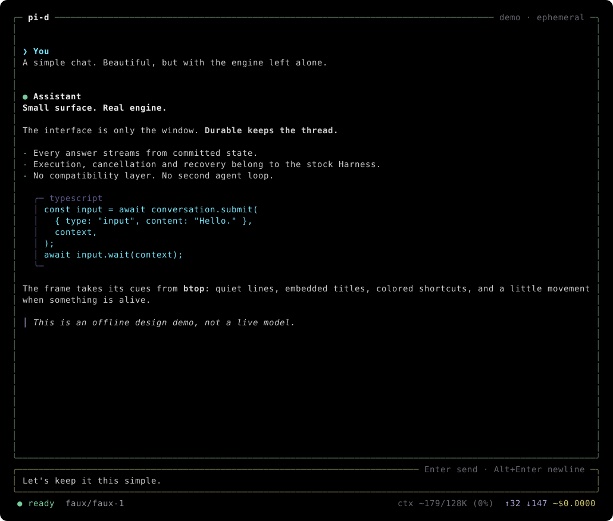

# pi-d

pi-d is a terminal coding agent built on [pi-durable](https://github.com/earendil-works/pi/tree/main/packages/durable), with a [btop](https://github.com/aristocratos/btop)-inspired interface. It can read files, run shell commands and edit code. Durable **automatically compacts older context in the background** and saves conversations and unfinished work in SQLite so you can resume them later.

The upstream Harness runs unchanged. pi-d adds the fullscreen interface, session controls, login storage, instruction discovery and built-in native subagent orchestration.

**Tools and trusted extensions run with your account's permissions. There is no sandbox or per-call approval.** Review changes and isolate unfamiliar projects.



Offline renderer capture with scripted output.

- **Automatic background context compaction.** Enabled by default through pi-durable: older context is summarized while chat can continue. Recent messages stay in context; earlier entries remain saved in SQLite. [Details](docs/usage.md#compaction-and-history).
- Watch answers, provider-exposed thinking and tool output as they stream.
- Review tool failures and committed edit patches in the conversation.
- Keep separate project sessions with saved models, reasoning levels and workspaces.
- Steer a running task or queue a follow-up through Durable.
- Load AGENTS instructions, skills and trusted Durable extensions, including local commands, UI-only messages/toasts and footer status.
- Delegate with [built-in subagents](docs/subagents.md): explicit per-worker skills/extensions, normal coding tools without worker-count/time/call budgets, non-nesting native tasks, nonblocking coordinator steering/cancellation and automatic completion callbacks. Available on normal startup without extension setup; workers start only when delegated. An isolated launch helper is also available.

## Quick start

Requires Node.js 22.19+, npm and a POSIX Unicode terminal. Offline checks run on macOS; Linux, Windows and Bun still need verification. Store sessions on a local disk.

Clone the repository and try the offline demo:

```sh
git clone https://github.com/archsinit/pi-d.git
cd pi-d
npm ci --ignore-scripts
npm run demo
```

Type a prompt. A scripted answer streams through the Durable Harness in a fullscreen terminal. The demo makes no model requests, uses no credentials or tools, and saves no conversations. Press Ctrl+C to close it.

### Add the `pi-d` command

From the same checkout:

```sh
mkdir -p "$HOME/.local/bin"
ln -s "$(pwd)/bin/pi-d.mjs" "$HOME/.local/bin/pi-d"
pi-d --help
pi-d --demo
```

Add `~/.local/bin` to PATH if needed. The link follows this checkout, so source changes take effect on the next launch. It will not overwrite an existing entry. Without the link, use `npm start -- <options>`.

There is no public npm release. You can also [build and install a local package](docs/usage.md#install-a-local-package).

## Start coding

Replace `/path/to/project` with your project directory:

```sh
# Connect a ChatGPT subscription using Pi's stock Codex OAuth flow.
pi-d --login

# Start a separate conversation for a project.
pi-d --new-session --cwd /path/to/project

# Later, choose a conversation saved for that workspace.
pi-d --resume --cwd /path/to/project

# Or open a specific database with another provider's environment credentials.
pi-d --session ./notes.sqlite --cwd /path/to/project --model anthropic/claude-opus-4-7
```

You can also sign in with `/login` inside chat. Choose browser or device-code login. Paste callback codes only into the login prompt, never ordinary chat. Completing in-app login can resume unfinished work and consume quota.

New sessions default to `openai-codex/gpt-6.1-sol` with `max` reasoning. Saved sessions retain their model, reasoning and workspace. Use `/model` and `/reasoning` to change them while idle.

OpenAI access is subscription-only: pi-d never falls back to `OPENAI_API_KEY`. Other providers use pi-ai's environment or ambient authentication, such as `ANTHROPIC_API_KEY` or `GEMINI_API_KEY`. pi-d stores no API keys and exposes only the Codex OAuth login. Model access depends on your provider account.

Plain `pi-d` reopens the shared `default.sqlite`, even when launched from another project. Use `--new-session` for a separate conversation. `/new` and `/clear` reset context in the current database while keeping its stored history and settings.

### In chat

Enter accepts a visible completion; otherwise it sends input when idle or runs a slash command. Tab completes commands, skills, model IDs and reasoning levels. Alt+Enter inserts a newline. Escape dismisses a completion or dialog; otherwise it cancels foreground work. Ctrl+C copies an active selection, cancels a local command or closes the app.

While a task runs, ordinary Enter keeps your draft. Use `/steer text` to guide its next turn or `/followup text` to queue work after it finishes. `/interrupt` stops foreground work and withdraws queued inputs; background tasks and existing file changes remain.

`/help` lists commands. `/status` shows the saved workspace, session path, authentication and recovery state. `/notifications` inspects active/queued UI notifications: Up/Down selects, PgUp/PgDn scrolls, `d` dismisses selected, Ctrl+D dismisses all, Enter closes. See the [command and keyboard reference](docs/usage.md#commands) for the full controls.

## How it differs from pi

pi-d uses Durable's APIs and execution model. Matching every [pi](https://pi.dev) feature is outside its scope. The comparison baseline is pi 1.2.0.

| Area | pi | pi-d |
| --- | --- | --- |
| Foundation | Pi coding-agent session runtime | Stock pi-durable Harness |
| Storage | JSONL session tree | SQLite conversations, submissions and tasks |
| Context management | Automatic threshold/overflow compaction; manual `/compact` | Automatic background context compaction via Durable; can overlap chat |
| Sessions | `/new`, tree/fork/clone, session picker | Separate databases via `/session-new`; `/new` resets current context |
| Busy input | Enter steers; Alt+Enter follows up | `/steer` and `/followup`; ordinary Enter keeps the draft |
| Extensions | Pi `ExtensionAPI`, discovery, packages and reload | Durable Extension objects; global config discovery and explicit files; restart to reload |
| Resources and integrations | Settings, providers, templates, themes, packages and built-in MCP | AGENTS, skills, pinned catalog and a fixed design; integrations need trusted Durable extensions |
| Automation and history | Print/JSON/RPC/SDK, branching, export/import/share | Interactive chat; no archive browser, headless modes or export/import/share |

The [full comparison](docs/comparison.md) covers commands, authentication, tools, discovery and platform differences. It also lists Durable APIs that pi-d does not expose. Pi extensions and sessions are not compatible with pi-d; reviewed skill files can be reused explicitly.

## Data and safety

Credentials, global instructions/skills and trusted extensions live in `~/.config/pi-d/`. Conversations live in `~/.local/share/pi-d/`. Absolute `XDG_CONFIG_HOME` and `XDG_DATA_HOME` replace those bases. Credentials are plaintext private files, separate from session databases. pi-d does not import Pi's credentials, settings or conversations.

Place trusted extension files or folders with an `index.ts` / `index.js` / `index.mjs` / `index.cjs` entry point in `~/.config/pi-d/extensions/` to load them automatically from any workspace. `--no-extensions` disables automatic external loading, not built-in tools/subagents; `--extension path` still adds explicit files. Project extension folders are not auto-loaded. Extensions can contribute local commands with help/completion, labeled scrollback messages, top-left notifications and styled footer items through the optional `piD` API, while keeping their state and behavior in native Durable documents/hooks. See the [extension guide](docs/extensions.md) for examples, trust and discovery rules.

**Recovery can repeat model requests and consume quota or incur charges.** Cancelling a task does not undo file or shell effects. Missing login or recovery extensions keeps work paused; use `/status` to inspect it.

Keep these limits in mind:

- Use one pi-d process per session database on local disk. A crashed owner's advisory lock expires after five minutes. Do not remove a live lock.
- Back up a closed database. Copying a live SQLite main file can omit its write-ahead log.
- Reset and compaction retain earlier entries in storage, but the display shows only active context. There is no archive browser or export command.
- The footer's `ctx ~` estimates active context. It does not measure remaining subscription quota or cumulative usage.
- pi-d has no image-upload UI, manual `/compact` or package installer. [Background delegation](docs/subagents.md) is built in, using native Durable tasks and child conversations; workers do not run as separate services. Recovery from host power loss is not guaranteed.

Read [Usage and safety](docs/usage.md) for paths, authentication, recovery and discovery rules. Read the [extension guide](docs/extensions.md) before loading executable files. Extensions use Durable's format and have full account access.

## Development

```sh
npm ci --ignore-scripts
npm run check
npm test
npm run smoke          # Python 3 + POSIX PTY; offline terminal checks
npm run test:package   # Build + isolated cached local/global-prefix install checks
npm run preview        # Regenerate the README's offline SVG preview
```

Tests use faux providers, stubbed OAuth and temporary workspaces. Live sign-in, model access, quota behavior and live compaction still need release verification. The [verification notes](docs/usage.md#verification) cover test scope and unverified platforms.

The app pins pi-durable, pi-ai and pi-tui to 1.2.0. `npm-shrinkwrap.json` pins the dependency graph. Durable's API is experimental, so upgrades need review. npm publishing remains disabled with `private: true`.

## Credits

- [Pi](https://github.com/earendil-works/pi), by Mario Zechner and the Pi contributors: pi-ai, pi-tui, and the coding prompt, tool guidelines and skill wording adapted here.
- [pi-durable](https://github.com/earendil-works/pi/tree/main/packages/durable), from the Pi/Earendil Works project: the unmodified Harness behind execution, persistence, background context compaction and recovery.
- [btop++](https://github.com/aristocratos/btop), by Aristocratos: terminal design inspiration and the adapted default-theme palette. No btop renderer or artwork is copied.

pi-d was created using pi. It does not use Pi's session runtime. See [NOTICE](NOTICE) and the bundled [Pi](licenses/pi.txt) and [btop](licenses/btop.txt) licenses for upstream material.

pi-d is an independent application, not an official release of the Pi, Earendil Works or btop projects.

## License

pi-d's original application code is licensed under the [MIT License](LICENSE). Adapted upstream material retains the notices and licenses listed above.
